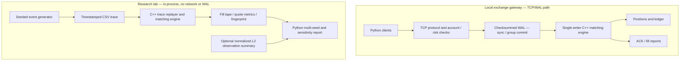

# Micro Exchange — C++20 Matching Engine, Durable Gateway & Microstructure Lab

**v1.0.0 · research-grade educational exchange simulator · no real-money trading**

A fully inspectable limit-order matching engine and local networked exchange, with deterministic order replay, write-ahead recovery, request-ID idempotency, journal group commit, crash/failure simulation, and **multi-seed synthetic order-flow sensitivity experiments**. The research simulator is intentionally separate from the networked execution gateway.

## What is demonstrated

| Subsystem | Features | Evidence / boundary |
|---|---|---|
| C++ matching engine | Integer price ticks; price-time FIFO; partial fills; market/limit; IOC/GTC; cancel and priority-aware replace | C++ tests and deterministic order replay |
| Local TCP gateway | Multiple connections, registered accounts, ownership, self-trade prevention, conservative position checks | Python integration tests; localhost only |
| Persistence | Checksummed write-ahead journal, strict sync, event-loop group commit, crash replay, durable request IDs for retry safety | Fault-injection and post-restart tests, **not** power-cut/hardware validation |
| Accounting | Signed positions, synthetic tick-unit cash flows, realized/unrealized P&L, ledger reconciliation | Simplified simulator; **not** broker accounting |
| Market-flow research | Seeded synthetic NEW/CANCEL/REPLACE/IOC streams, calm/volatile/stress scenarios, exact trace/fill-tape replay | In-process C++ runner, **not** observed exchange order IDs |
| **v1.0 research workflow** | Tunable assumptions, 5-scenario × 5-seed experiments, run-level CSV/JSON, summary with ranges and replay checks | 13 automated test suites passed on Linux; 25/25 Windows synthetic study runs replay-verified; Windows 13-suite CTest log not archived |

## Architecture



**Important separation:** The synthetic lab does **not** measure network throughput, live execution latency, or production durability. Nor does it reconstruct order IDs/cancellations/queue priority from aggregate Kraken L2 snapshots.

## Windows quickstart

Extract this repository to a folder of your choice (the following examples assume the ZIP is under Downloads).

**Window A — x64 Native Tools Command Prompt for VS 2022**:

```cmd
cd /d "%USERPROFILE%\Downloads\micro-exchange-cpp-v1.0.0\micro-exchange-cpp"
powershell -ExecutionPolicy Bypass -File .\run_windows.ps1
```

Expected: `100% tests passed out of 13`. The runner also executes a deterministic demonstration and a synthetic in-memory benchmark. The Windows **research experiment** has been run and verified; the complete Windows **13-suite CTest output** has not been archived and is not claimed here.

**Window B — regular Windows PowerShell**, once the build completes:

```powershell
cd "$HOME\Downloads\micro-exchange-cpp-v1.0.0\micro-exchange-cpp"

py -3 .\sim\experiment_v10.py --executable .\build\Release\exchange_flow_sim.exe --output-dir .\benchmarks\windows_v100 --seeds 11,23,37,41,53 --events 3000 --profile mixed
```

Results to inspect: `benchmarks\windows_v100\EXPERIMENT_V100.md` (research report), `EXPERIMENT_V100.json` (full machine-readable report), `RUNS_V100.csv` (per-seed results), and the generated traces/fill tapes under named scenario folders. The experiment runner **generates and replays** every trace and compares the exact fill-tape bytes before recording success.

To run an individual sensitivity experiment:

```powershell
.\build\Release\exchange_flow_sim.exe --generate .\benchmarks\one_scenario.csv --seed 42 --events 12000 --profile mixed --cancel-shift-points 10 --aggression-shift-points 10 --summary .\benchmarks\one_scenario.json
.\build\Release\exchange_flow_sim.exe --replay .\benchmarks\one_scenario.csv --expect-summary .\benchmarks\one_scenario.json
```

### v1.0 scenario controls

| Control | Range | Meaning |
|---|---:|---|
| `--arrival-scale-percent` | 50–200 | Multiplies simulated arrival intensity; **does not change** event order for a fixed seed |
| `--size-scale-percent` | 50–200 | Multiplies each regime's maximum synthetic order quantity |
| `--aggression-shift-points` | 0–20 | Transfers percentage points from passive NEW to aggressive NEW |
| `--cancel-shift-points` | 0–20 | Transfers percentage points from passive NEW to cancellation |

The two shifts must preserve a positive passive-order probability; invalid ranges fail rather than silently clamping. All v1.0 generated traces use `MEXFLOW2` with explicit tuning (including defaults); legacy `MEXFLOW1` traces and original v0.9 expected-summary files remain byte-for-byte replayable. Generator settings are **assumptions**, not fitted parameters.

## Research example (Linux, **synthetic**, 5 seeds × 5 scenarios)

The included [reproducible example report](benchmarks/EXAMPLE_V100_SYNTHETIC_STUDY.md) and [individual run data](benchmarks/EXAMPLE_V100_SYNTHETIC_RUNS.csv) were produced with 3,000 generated events per run. Illustrative medians:

| Assumption | Synthetic event rate / sec | Executions per generated event | Mean quoted spread (ticks) |
|---|---:|---:|---:|
| Baseline | 4,093 | 0.464 | 1.789 |
| Arrival intensity ×1.5 | 6,139 | 0.464 | 1.789 |
| Cancellation share +10 percentage points | 4,086 | 0.294 | 4.054 |
| Aggressive NEW share +10 percentage points | 4,182 | 0.452 | 5.032 |
| Max order size ×1.5 | 4,093 | 0.471 | 1.626 |

Simulated event rate is derived from artificial event timestamps, **not processing throughput**. Fixed-event-count order and fill results are unchanged under arrival-only scaling because this toy model has no elapsed-time-dependent book dynamics. Values vary by seed; see the min–max ranges in the full report. These numbers do **not** describe Kraken or another trading venue.

## Verified Windows v1.0 synthetic sensitivity study (2026-11-10)

The [Windows report](benchmarks/WINDOWS_V100_SYNTHETIC_STUDY.md) and [underlying JSON](benchmarks/WINDOWS_V100_SYNTHETIC_STUDY.json) document **25/25 generated-trace and trade-tape replay checks** across five scenarios and seeds 11, 23, 37, 41, and 53 (3,000 generated events per run, plus 16 preload events). The source JSON records executable SHA-256 `48afa40f1de5a34cb2b325093882766f8339bb8068d918f6a49ac8ec7e3b0100`.

| Scenario assumption | Median fills per event | Median of per-run mean spread (ticks) | Median executed quantity per event |
|---|---:|---:|---:|
| Baseline | 0.464 | 1.789 | 3.526 |
| Arrival intensity +50% | 0.464 | 1.789 | 3.526 |
| Cancellation probability +10 percentage points | 0.294 | 4.054 | 2.266 |
| Aggressive NEW probability +10 percentage points | 0.452 | 5.032 | 3.256 |
| Maximum order size +50% | 0.471 | 1.626 | 5.297 |

The arrivals-only scenario changes **timestamps and simulated event rate**, but not event order, matching or fills. That is a **model limitation**, not a conclusion about real markets. These outputs are synthetic quote and matching outcomes, **not** Kraken calibration, market-performance forecasts, actual order-flow measurements, TCP throughput, or trading returns. Statistical intervals or causal inference are not established by five paired seeds. There is no `l2_reference` in the JSON.

## Optional normalized aggregate L2 observation comparison

If you have reliable, independently normalized **best-quote** data, prepare a CSV with these exact columns:

```csv
timestamp_us,best_bid_ticks,best_ask_ticks,bid_qty,ask_qty,trade_side,trade_qty
1000000,10000,10002,4.1,3.6,NONE,0
1001200,10001,10003,3.9,4.0,BUY,0.05
```

The rows above are **invented schema examples, not Kraken data**. Price units must be common integer ticks; `bid_qty` and `ask_qty` are **best-price sizes**, not aggregate depth-5. `trade_side` must be known, else use `NONE,0`. See `sim/inspect_l2.py` for validation and constraints.

```powershell
py -3 .\sim\inspect_l2.py --input .\data\normalized_quotes.csv --output .\benchmarks\l2_observations.json
py -3 .\sim\experiment_v10.py --executable .\build\Release\exchange_flow_sim.exe --output-dir .\benchmarks\windows_v100_l2 --l2-summary .\benchmarks\l2_observations.json
```

The output compares only **quoted spread**, **best-quote imbalance** and **absolute midprice change per quote observation**. It deliberately does not compare L2 best-quote imbalance to simulator depth-five imbalance. A meaningful empirical assessment still requires matching instrument, tick size, observation interval, units and sampling protocol. No empirical observation file is bundled; **the program does not automatically calibrate parameters**.

## Linux / macOS build (where supported)

```bash
cmake -S . -B build -DCMAKE_BUILD_TYPE=Release
cmake --build build --parallel
ctest --test-dir build --output-on-failure
python3 sim/experiment_v10.py --executable ./build/exchange_flow_sim --output-dir ./benchmarks/local_v100 --events 3000
```

## Validation, interpretation and limits

- All **13 CTest suites** passed on Linux Release and sanitizer builds in the release preparation environment. The **Windows 25/25 replay-verified research runs** are archived; a separate **Windows 13/13 CTest log** is still needed for a fully evidenced Windows test-suite claim. See [`docs/RELEASE_VALIDATION_V100.md`](docs/RELEASE_VALIDATION_V100.md).
- WAL recovery and fault injection concern **controlled process faults**; do not infer survival of actual power loss, controller caching, filesystem corruption, or hardware failures.
- Earlier **Windows v0.7 and v0.8.1** durable-throughput comparisons are historical. Their unexplained disk-sync variability is described in [`benchmarks/WINDOWS_V080_AB_INVESTIGATION.md`](benchmarks/WINDOWS_V080_AB_INVESTIGATION.md). The v1.0 flow study produces no network/WAL performance claims.
- There's no connected exchange, broker funding, clearing, commissions, queue-position estimation, statistical alpha, or trading strategy profitability claim.
- Source is ready to publish to GitHub, but **choose a license before granting reuse rights**; no license has been selected on the user's behalf.

For implementation notes see [`DESIGN.md`](DESIGN.md), [`docs/RESEARCH_METHOD_V100.md`](docs/RESEARCH_METHOD_V100.md), and [`CHANGELOG.md`](CHANGELOG.md). The GitHub Actions workflow builds/tests Linux and Windows on pushes and pull requests.
